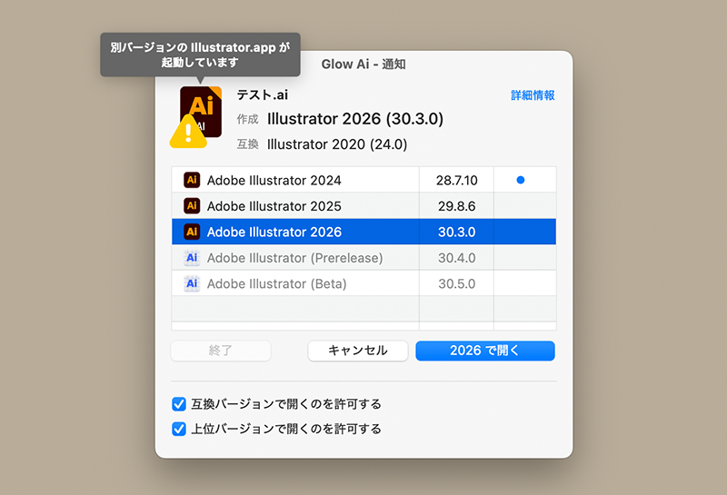

# Glow Ai

macOS用デスクトップアプリ

## 用途

Glow Ai は、Adobe Illustrator ファイル（.ai / .ait / .eps）を、そのファイルが作成されたバージョンの Illustrator で自動的に開くユーティリティアプリです。EPS ファイルが Photoshop で作成されていた場合は、通知ウインドウを表示してどのバージョンの Photoshop で開くかを選択できます。Illustrator編集機能を保持したPDFファイルに対応。

## 使い方

.ai / .ait / .eps ファイルを Glow Ai に関連付けておくと、ファイルをダブルクリックするだけで Glow Ai が起動し、バージョンを判定して適切な Illustrator で開きます。

Glow Ai は、ファイルの関連付けを自動では変更しません。関連付けるには、環境設定の「ファイルの関連付け」で Glow Ai を選んで「関連付ける」をクリックしてください。macOS Tahoe 26.4 以降は、書類の種類ごとに macOS の確認メッセージが表示されるので、Glow Ai への変更を選んでください。元に戻すには、同じ場所で Illustrator を選びます。

環境設定で関連付けが変わらない場合は、Finder で .ai ファイルを選んで「情報を見る」を開き、「このアプリケーションで開く」で Glow Ai を選んで「すべてを変更…」をクリックしてください。.ait / .eps ファイルでも同じ操作をします。

1. .ai / .ait / .eps ファイルをダブルクリックします。
2. Glow Ai が起動し、ファイルの作成バージョンを判定します。
3. バージョンが一致する Illustrator が見つかれば自動的に開きます。見つからない場合や、確認が必要な場合は通知ウインドウが表示されます。

詳細は、Glow Ai のヘルプメニュー「Glow Aiヘルプ」を選択してください。

## トラブルシューティング
起動時に『Glow Aiをアプリケーションフォルダへ移動してください』または『Glow AiをFinderで移動し直してください』とアラートが出たときの対処方法。

1. アラートの「終了」をクリック
2. Finder で Glow Ai をアプリケーションフォルダへ移動（すでにアプリケーションフォルダにある場合は、いったんデスクトップへ移動してから戻す）
3. Glow Ai を起動

## 動作環境

macOS 13.5 Ventura 以降（Universal Binary）

## ライセンス

This project is licensed under the MIT License - see the [LICENSE](LICENSE) file for details.
