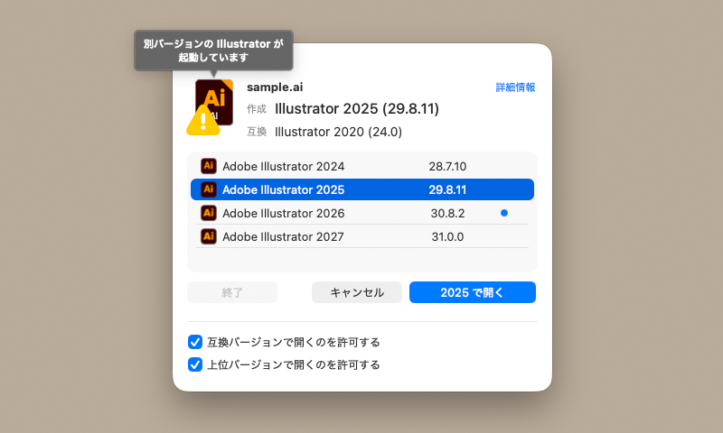

# Glow Ai

macOS用デスクトップアプリ

## 用途

Glow Ai は、Adobe Illustrator ファイル（.ai / .ait / .eps）を、そのファイルが作成されたバージョンの Illustrator で自動的に開くユーティリティアプリです。

Illustrator ファイルは、作成バージョンと異なる Illustrator で開くと、レイアウトやオブジェクトの構造が変化してしまうことがあります。トラブルを回避するには、ファイルの作成バージョンを正確に把握し、同じバージョンの Illustrator で開く必要があります。

Glow Ai は、ファイルの内部に記録されている作成バージョンを読み取り、同じバージョンの Illustrator を選んで自動的に開きます。

## 使い方

.ai / .ait / .eps ファイルを Glow Ai に関連付けておくと、ファイルをダブルクリックするだけで Glow Ai が起動し、バージョンを判定して適切な Illustrator で開きます。

### 前準備：ファイルの関連付け

1. Glow Ai を起動し、Dock メニューから「設定…」を選択します
2. 設定の「ファイルの関連付け」で Glow Ai を選択し、「関連付ける」ボタンを押します
3. 「アイコンを取り込む」ボタンが押せる状態なら押します

この操作で関連付けが変わらない場合は、Finder で .ai ファイルを選んで「情報を見る」を開き、「このアプリケーションで開く」で Glow Ai を選んで「すべてを変更…」をクリックしてください。.ait / .eps ファイルでも同じ操作をします。

### 使う

1. .ai / .ait / .eps ファイルをダブルクリックします
2. Glow Ai が起動し、ファイルの作成バージョンを判定します
	- バージョンが一致する Illustrator が見つかれば、自動的にその Illustrator で開きます
	- バージョンが一致する Illustrator がない場合や、ユーザーの確認を要する場合は、通知ウインドウが表示されます

詳細は、Glow Ai のヘルプメニュー「Glow Ai ヘルプ」を選択してください。

## 動作環境

macOS 13.5 Ventura 以降（Universal Binary）

## ライセンス

This project is licensed under the MIT License - see the [LICENSE](LICENSE) file for details.
